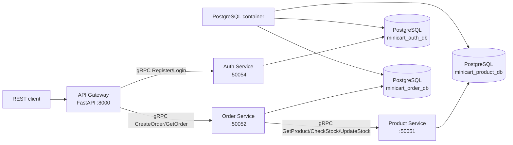

# MiniCart

MiniCart is a local microservices e-commerce application built with Python, FastAPI, gRPC, Protocol Buffers, SQLAlchemy, PostgreSQL, and Docker Compose.

The implemented system provides account registration and login, product and inventory management, authenticated order creation and retrieval, and bounded retry/circuit-breaker protection for synchronous service calls.

## Project Overview

The repository contains four running service components:

| Component | Technology | Default port | Responsibility |
|---|---|---:|---|
| API Gateway | FastAPI/Uvicorn | `8000` | Exposes REST endpoints and forwards authentication and order operations over gRPC. |
| Auth Service | Python/gRPC | `50054` | Registers users, verifies passwords, and issues RS256 JWT access tokens. |
| Product Service | Python/gRPC | `50051` | Owns products and inventory, including stock updates and stock-operation idempotency. |
| Order Service | Python/gRPC | `50052` | Owns orders and order items, validates authenticated users, coordinates Product Service calls, and stores CreateOrder idempotency state. |

PostgreSQL is run by Docker Compose on local port `5432`. It is not an application service in Docker; the four application processes currently run directly under their Python virtual environments.

No implemented Payment Service directory, Payment protobuf contract, Payment database, or payment workflow is currently present in this repository.

## Architecture Overview



All downstream application communication shown above is synchronous gRPC. The API Gateway does not connect directly to PostgreSQL.

### Service Responsibilities

- **API Gateway:** validates REST input and JWTs, forwards the Bearer token and `Idempotency-Key`, translates gRPC statuses to HTTP statuses, and retries selected read-only and CreateOrder RPC calls.
- **Auth Service:** validates registration data, normalizes email addresses, stores Argon2 password hashes, verifies credentials, and signs JWT access tokens.
- **Product Service:** manages products and inventory in the product database. `UpdateStock` records a stable operation ID and payload hash so a replay returns the stored stock result instead of deducting inventory twice.
- **Order Service:** verifies JWT claims, checks authoritative product prices and stock, creates order rows and order items, updates inventory, compensates inventory after failures where applicable, and stores user-scoped CreateOrder idempotency responses.

## Technology Stack

- Python 3.13
- FastAPI and Uvicorn
- gRPC and Protocol Buffers
- PostgreSQL 17
- SQLAlchemy 2
- psycopg2-binary
- PyJWT and RSA keys
- Argon2 password hashing
- python-dotenv
- Docker Compose
- pytest
- Pylance/Pyright-compatible Python typing configuration

## Implemented Features

- User registration and login through REST and gRPC.
- RS256 JWT issuance and independent JWT verification by the Gateway and Order Service.
- Protected `POST /orders` and `GET /orders/{order_id}` operations.
- Product creation, retrieval, stock checks, and stock updates.
- Service-owned PostgreSQL databases and SQLAlchemy models.
- CreateOrder user-scoped idempotency with payload-hash conflict detection.
- UpdateStock operation-ID idempotency with atomic inventory and operation-record updates.
- Bounded gRPC retries with exponential backoff and jitter.
- Independent circuit breakers for Gateway-to-Order and Order-to-Product communication.
- Unique test-data cleanup across the service databases.
- Database, migration, security, idempotency, retry, circuit-breaker, integration, and E2E test suites.

## Fault Tolerance and Reliability

### Retries and Exponential Backoff

The shared retry implementation is [generated/grpc_retry.py](./generated/grpc_retry.py). It uses:

| Setting | Default |
|---|---:|
| Maximum attempts | `4` |
| Initial delay | `0.2` seconds |
| Multiplier | `2` |
| Maximum delay | `1.0` second |
| Jitter ratio | `0.25` |

It retries `UNAVAILABLE` and `DEADLINE_EXCEEDED` where the overall deadline allows another attempt. Permanent statuses such as `INVALID_ARGUMENT`, `NOT_FOUND`, `FAILED_PRECONDITION`, `ALREADY_EXISTS`, `UNAUTHENTICATED`, and `PERMISSION_DENIED` stop the retry sequence.

Retry-protected read/write operations are:

- `GetProduct`
- `CheckStock`
- `UpdateStock`
- Gateway `GetOrder`
- Gateway `CreateOrder`

CreateOrder and UpdateStock reuse the same request object, metadata, and operation/idempotency identifier on every retry.

### Circuit Breakers

The reusable thread-safe implementation is [generated/circuit_breaker.py](./generated/circuit_breaker.py). It supports `CLOSED`, `OPEN`, and `HALF_OPEN` states.

The two breakers are independent:

- Gateway → Order Service
- Order Service → Product Service

A logical retry sequence is counted as one circuit-breaker outcome. Permanent gRPC errors do not open a breaker. When OPEN, no downstream gRPC call or retry sequence is started.

### Idempotency

`POST /orders` requires an `Idempotency-Key` header. The Gateway forwards it unchanged to the Order Service. The Order Service scopes the key to the authenticated `sub` claim and compares the request payload hash.

- Reusing the same key and payload returns the stored CreateOrder response.
- Reusing the key with a different payload returns `ALREADY_EXISTS`, mapped to HTTP `409`.
- Concurrent duplicates are protected by a database unique constraint.
- UpdateStock uses a separate stable `operation_id`; Product Service stores the operation payload hash and returned stock value in the same transaction as the inventory update.

### Response-Loss Handling

Test-only gRPC wrappers can simulate a response being lost after the downstream database transaction commits. Existing tests verify that the Gateway or Order Service retries the same logical request and that the replayed idempotent operation does not create duplicate orders or deduct stock twice.

## Project Directory Structure

```text
MiniCart/
├── api-gateway/
│   ├── gateway/
│   │   ├── auth_client.py
│   │   ├── grpc_client.py
│   │   ├── main.py
│   │   ├── schemas.py
│   │   └── security.py
│   ├── tests/
│   └── requirements.txt
├── auth-service/
│   ├── auth_database.py
│   ├── auth_models.py
│   ├── auth_security.py
│   ├── generate_keys.py
│   ├── server.py
│   ├── servicer.py
│   ├── token_issuer.py
│   ├── tests/
│   └── requirements.txt
├── product-service/
│   ├── database.py
│   ├── models.py
│   ├── seed_products.py
│   ├── server.py
│   ├── servicer.py
│   ├── tests/
│   └── requirements.txt
├── order-service/
│   ├── clients/
│   │   └── product_client.py
│   ├── database.py
│   ├── models.py
│   ├── security.py
│   ├── security_config.py
│   ├── server.py
│   ├── servicer.py
│   ├── tests/
│   └── requirements.txt
├── protos/
│   ├── auth.proto
│   ├── order.proto
│   └── product.proto
├── generated/
│   ├── auth_pb2.py
│   ├── order_pb2.py
│   ├── product_pb2.py
│   ├── grpc_retry.py
│   └── circuit_breaker.py
├── tests/
│   ├── circuit_breaker/
│   ├── database/
│   ├── e2e/
│   ├── gateway/
│   ├── idempotency/
│   └── security/
├── docker/postgres/
├── docker-compose.yml
├── initialize_databases.py
├── generate_protos.py
├── start-minicart.ps1
├── run-integration-tests.ps1
├── .env.example
└── requirements.txt

## Database Architecture

PostgreSQL has one container and separate databases:

| Service | Database | Managed tables |
|---|---|---|
| Auth Service | `minicart_auth_db` | `users` |
| Product Service | `minicart_product_db` | `products`, `inventory`, `processed_stock_operations` |
| Order Service | `minicart_order_db` | `orders`, `order_items`, `order_idempotency` |

### Ownership Rules

- Each service has its own SQLAlchemy `Base`, engine, and database name.
- The Gateway does not connect to PostgreSQL.
- No cross-service foreign key is declared by the Order or Payment-side models.
- `order_items.product_id` is an integer reference only; it does not declare a foreign key to `products`.
- `processed_stock_operations.product_id` is an application operation identifier and does not declare a cross-service foreign key.

The Docker Compose script creates the Auth database as `POSTGRES_DB` and creates the Product and Order databases on first PostgreSQL initialization. SQLAlchemy `create_all()` initializes the three service schemas. The repository also contains SQL migration test fixtures, but the service `migrations/` directories referenced by those tests are not currently present in the checkout.

## Prerequisites

- Windows PowerShell
- Python 3.13
- Docker Desktop with Docker Compose
- PostgreSQL-compatible Docker support
- Network access from local processes to `127.0.0.1`

Optional for test containers: Docker must be able to start temporary PostgreSQL containers.

## Environment Variables and Configuration

Create a local environment file:

```powershell
Copy-Item .env.example .env
```

Never commit `.env`, private RSA keys, or issued JWTs.

### PostgreSQL

| Variable | Purpose | Example default |
|---|---|---|
| `DB_HOST` | PostgreSQL host for local processes | `localhost` |
| `DB_PORT` | PostgreSQL port | `5432` |
| `DB_USER` | Shared development database user | `minicart_admin` |
| `DB_PASSWORD` | Database password | Set locally; no default |
| `AUTH_DB_NAME` | Auth database | `minicart_auth_db` |
| `PRODUCT_DB_NAME` | Product database | `minicart_product_db` |
| `ORDER_DB_NAME` | Order database | `minicart_order_db` |

### Service Addresses

| Variable | Purpose | Default |
|---|---|---|
| `AUTH_SERVICE_ADDRESS` | Auth gRPC target | `localhost:50054` |
| `AUTH_SERVICE_TIMEOUT_SECONDS` | Auth gRPC deadline | `5` |
| `ORDER_SERVICE_ADDRESS` | Order gRPC target | `localhost:50052` |
| `ORDER_SERVICE_TIMEOUT_SECONDS` | Order gRPC deadline | `3` |
| `PRODUCT_SERVICE_ADDRESS` | Product gRPC target | `localhost:50051` |
| `PRODUCT_SERVICE_TIMEOUT_SECONDS` | Product gRPC deadline | `3` |

Each service also supports matching host and port variables; the address variables take precedence.

### Authentication

| Variable | Purpose | Default |
|---|---|---|
| `JWT_PRIVATE_KEY_PATH` | Auth Service RSA private key path | `auth-service/keys/jwt-private.pem` |
| `JWT_PUBLIC_KEY_PATH` | Verifier RSA public key path | `auth-service/keys/jwt-public.pem` |
| `JWT_ISSUER` | JWT issuer | `minicart-auth` |
| `JWT_AUDIENCE` | JWT audience | `minicart-api` |
| `JWT_ACCESS_TOKEN_SECONDS` | Access-token lifetime | `900` |

### Retry and Circuit Breakers

Retry variables:

| Variable | Default |
|---|---:|
| `GRPC_RETRY_MAX_ATTEMPTS` | `4` |
| `GRPC_RETRY_INITIAL_DELAY_SECONDS` | `0.2` |
| `GRPC_RETRY_MULTIPLIER` | `2` |
| `GRPC_RETRY_MAX_DELAY_SECONDS` | `1.0` |
| `GRPC_RETRY_JITTER_RATIO` | `0.25` |

Gateway → Order circuit breaker:

- `GATEWAY_ORDER_CB_FAILURE_THRESHOLD`
- `GATEWAY_ORDER_CB_RECOVERY_TIMEOUT_SECONDS`
- `GATEWAY_ORDER_CB_HALF_OPEN_MAX_CALLS`

Order → Product circuit breaker:

- `ORDER_PRODUCT_CB_FAILURE_THRESHOLD`
- `ORDER_PRODUCT_CB_RECOVERY_TIMEOUT_SECONDS`
- `ORDER_PRODUCT_CB_HALF_OPEN_MAX_CALLS`

The circuit breakers default to failure threshold `5`, recovery timeout `15` seconds, and half-open maximum calls `2`.

## Installation and Setup

Create the virtual environments:

```powershell
py -3.13 -m venv .venv
py -3.13 -m venv auth-service\.venv
py -3.13 -m venv product-service\.venv
py -3.13 -m venv order-service\.venv
py -3.13 -m venv api-gateway\.venv
```

Install dependencies:

```powershell
.\.venv\Scripts\python.exe -m pip install -r requirements.txt
.\auth-service\.venv\Scripts\python.exe -m pip install -r auth-service\requirements.txt
.\product-service\.venv\Scripts\python.exe -m pip install -r product-service\requirements.txt
.\order-service\.venv\Scripts\python.exe -m pip install -r order-service\requirements.txt
.\api-gateway\.venv\Scripts\python.exe -m pip install -r api-gateway\requirements.txt
```

Generate RSA keys:

```powershell
.\auth-service\.venv\Scripts\python.exe auth-service\generate_keys.py `
  --private-key auth-service\keys\jwt-private.pem `
  --public-key auth-service\keys\jwt-public.pem
```

Start PostgreSQL:

```powershell
docker compose up -d postgres
docker compose ps
docker compose exec postgres pg_isready -U minicart_admin -d minicart_auth_db
```

Initialize service schemas:

```powershell
.\.venv\Scripts\python.exe initialize_databases.py
```

Generate or refresh protobuf modules:

```powershell
.\.venv\Scripts\python.exe generate_protos.py
```

Optionally seed product data:

```powershell
.\.venv\Scripts\python.exe product-service\seed_products.py
```

The seed script is available but skipped product names already present. It requires the Product Service to be running.

## Running the Application

PostgreSQL is the only Docker Compose service. The application processes run locally.

Terminal 1:

```powershell
.\auth-service\.venv\Scripts\python.exe auth-service\server.py
```

Terminal 2:

```powershell
.\product-service\.venv\Scripts\python.exe product-service\server.py
```

Terminal 3:

```powershell
.\order-service\.venv\Scripts\python.exe order-service\server.py
```

Terminal 4:

```powershell
.\api-gateway\.venv\Scripts\python.exe -m uvicorn gateway.main:app --app-dir api-gateway --host 127.0.0.1 --port 8000
```

The repository also provides [start-minicart.ps1](./start-minicart.ps1). It starts PostgreSQL and launches the four application processes. It does not start Dockerized application containers.

## API Documentation

Swagger UI is available at `http://127.0.0.1:8000/docs`, and OpenAPI JSON is available at `http://127.0.0.1:8000/openapi.json`.

### `GET /health`

Checks that the Gateway process is responding. It does not perform database or downstream gRPC health checks.

```powershell
Invoke-RestMethod -Uri "http://127.0.0.1:8000/health"
```

Response:

```json
{
  "status": "ok"
}
```

### `POST /auth/register`

Creates an Auth Service account.

```powershell
Invoke-RestMethod -Uri "http://127.0.0.1:8000/auth/register" `
  -Method Post `
  -ContentType "application/json" `
  -Body '{"name":"Example User","email":"user@example.com","password":"example-password"}'
```

Password length must be 12–128 characters.

Response:

```json
{
  "id": 1,
  "name": "Example User",
  "email": "user@example.com",
  "created_at": "2026-01-01T00:00:00Z"
}
```

### `POST /auth/login`

Authenticates a registered user and returns a JWT.

```powershell
Invoke-RestMethod -Uri "http://127.0.0.1:8000/auth/login" `
  -Method Post `
  -ContentType "application/json" `
  -Body '{"email":"user@example.com","password":"example-password"}'
```

Response:

```json
{
  "access_token": "<JWT>",
  "token_type": "Bearer",
  "expires_in": 900
}
```

### `POST /orders`

Requires:

- `Authorization: Bearer <JWT>`
- `Idempotency-Key: <1-128-character key>`

The idempotency key may contain letters, digits, `.`, `_`, and `-`, and must begin with a letter or digit.

```powershell
$headers = @{
  Authorization = "Bearer <JWT>"
  "Idempotency-Key" = "order-example-001"
}

Invoke-RestMethod -Uri "http://127.0.0.1:8000/orders" `
  -Method Post `
  -Headers $headers `
  -ContentType "application/json" `
  -Body '{"items":[{"product_id":1,"quantity":2}]}'
```

Response:

```json
{
  "id": 1,
  "total_amount": "39.90",
  "status": "CONFIRMED",
  "created_at": "2026-01-01T00:00:00Z",
  "items": [
    {
      "id": 1,
      "product_id": 1,
      "quantity": 2,
      "unit_price": "19.95"
    }
  ]
}
```

### `GET /orders/{order_id}`

Requires `Authorization: Bearer <JWT>`. The Order Service returns only an order owned by the authenticated user.

```powershell
$headers = @{ Authorization = "Bearer <JWT>" }
Invoke-RestMethod -Uri "http://127.0.0.1:8000/orders/1" `
  -Headers $headers
```

## gRPC APIs

Protocol contracts are in [protos/](./protos/).

| Service | RPCs |
|---|---|
| Auth | `Register`, `Login` |
| Product | `AddProduct`, `GetProduct`, `CheckStock`, `UpdateStock` |
| Order | `CreateOrder`, `GetOrder` |

Generated Python modules are in [generated/](./generated/). Regenerate them with `generate_protos.py`.

## Testing

The project separates unit-style tests from integration tests that require running processes or PostgreSQL.

### Unit and Mock-Based Tests

```powershell
# Gateway
.\api-gateway\.venv\Scripts\python.exe -m pytest api-gateway\tests -v

# Authentication
.\auth-service\.venv\Scripts\python.exe -m pytest auth-service\tests -v

# Order authorization
.\order-service\.venv\Scripts\python.exe -m pytest order-service\tests\test_order_authorization.py -v

# Retry and circuit-breaker unit tests
.\.venv\Scripts\python.exe -m pytest tests\test_grpc_retry.py tests\test_dedicated_grpc_retries.py tests\test_circuit_breaker.py -v
```

### Product and Order Integration Tests

Require PostgreSQL and the relevant running gRPC services:

```powershell
docker compose up -d postgres
.\.venv\Scripts\python.exe initialize_databases.py
```

```powershell
.\product-service\.venv\Scripts\python.exe -m pytest product-service\tests -v
```

```powershell
.\order-service\.venv\Scripts\python.exe -m pytest order-service\tests -v
```

### Database Tests

Database isolation and initialization tests use temporary Docker PostgreSQL containers with temporary databases and a tmpfs data directory:

```powershell
.\.venv\Scripts\python.exe -m pytest tests\database -v
```

Migration test files reference migration scripts that are not currently present in the checkout, so the migration-focused cases cannot be considered implemented migration coverage until those SQL files exist.

### End-to-End and Gateway Integration Tests

Start PostgreSQL, Auth, Product, Order, and Gateway processes before running:

```powershell
.\.venv\Scripts\python.exe -m pytest tests\e2e -v
.\.venv\Scripts\python.exe -m pytest tests\gateway -v
```

### Idempotency and Response-Loss Tests

```powershell
.\.venv\Scripts\python.exe -m pytest tests\idempotency -v
.\.venv\Scripts\python.exe -m pytest tests\test_create_order_gateway_response_loss.py -v
.\.venv\Scripts\python.exe -m pytest tests\test_update_stock_mutation_response_loss.py -v
```

Integration tests require the documented running services and `.env` database credentials. Test cleanup is targeted to records created by the test fixtures.

### Circuit-Breaker Outage and Recovery Tests

The dedicated real-gRPC outage tests use test-owned temporary gRPC servers:

```powershell
.\.venv\Scripts\python.exe -m pytest tests\circuit_breaker -v
```

These tests do not stop or modify existing developer-owned service processes.

The repository also contains [run-integration-tests.ps1](./run-integration-tests.ps1), but it does not include every newer focused suite. The individual commands above are authoritative for the newly added test groups.

## Error Handling and Status Mapping

### REST Status Mapping

| gRPC status | HTTP status |
|---|---:|
| `INVALID_ARGUMENT`, `OUT_OF_RANGE` request rejection | `400` or `422` |
| `NOT_FOUND` | `404` |
| `RESOURCE_EXHAUSTED`, `FAILED_PRECONDITION`, `ALREADY_EXISTS` | `409` |
| `UNAUTHENTICATED` | `401` |
| `PERMISSION_DENIED` | `403` |
| `UNAVAILABLE` | `503` |
| `DEADLINE_EXCEEDED` | `504` |

The Gateway sanitizes downstream details and does not expose internal gRPC error text.

### gRPC Statuses

Implemented service handlers use statuses including:

- `INVALID_ARGUMENT` for malformed input.
- `NOT_FOUND` for missing users, products, or orders.
- `ALREADY_EXISTS` for idempotency or uniqueness conflicts.
- `FAILED_PRECONDITION` for invalid stock state or failed replay conditions.
- `RESOURCE_EXHAUSTED` for insufficient stock.
- `UNAVAILABLE` for database or temporary downstream failures.
- `DEADLINE_EXCEEDED` for gRPC deadline expiration.
- `UNAUTHENTICATED` for missing or invalid JWT credentials.

## Security Considerations

- Keep `.env` and RSA private/public key files outside version control.
- Use separate database credentials and permissions if this project is deployed beyond local development.
- Gateway and Order Service verify JWT issuer, audience, signature, expiration, and subject claims.
- User ownership is derived from `sub`; identity headers are not trusted.
- Passwords are hashed with Argon2.
- REST error responses avoid exposing downstream gRPC details.
- POST `/orders` is protected by both JWT authentication and an idempotency key.
- Circuit-breaker state is local to each process; it is not shared across replicas.
- The current database setup uses a shared development role and service-specific database names.

## Future Improvements

The following are not implemented:

- Docker images and containerized application startup.
- A Payment Service or payment database.
- Distributed payment processing or compensation.
- A complete migration framework and migration directories.
- Kubernetes deployment.
- Kafka or RabbitMQ.
- Redis.
- Distributed tracing or metrics.
- Separate PostgreSQL roles and permissions for each service.

Cross-service delivery is currently synchronous. Production deployment would require managed secrets, service discovery, TLS, observability, backup/restore procedures, and a defined migration rollout process.

## Additional Information

This README documents the current repository and intentionally distinguishes implemented behavior from test gaps or planned work. Where migration scripts are referenced by tests but missing from the checkout, this is reported rather than described as completed migration functionality.
